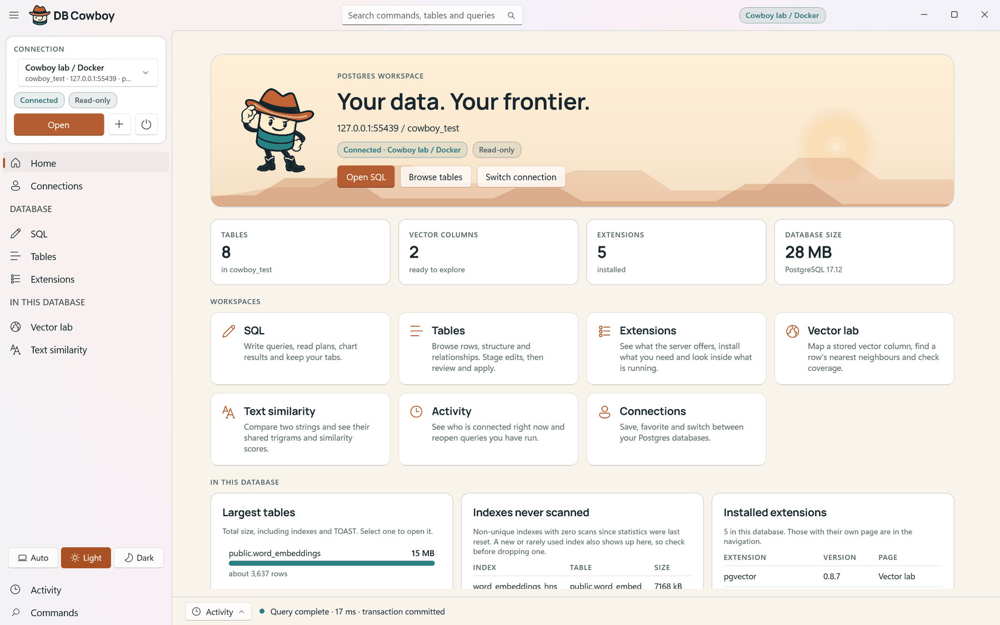
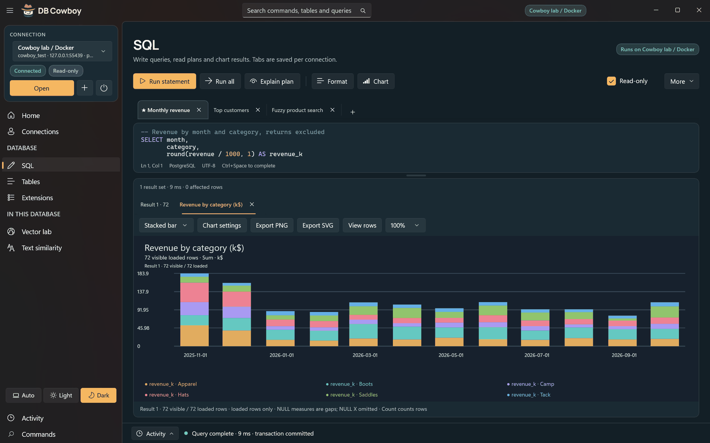
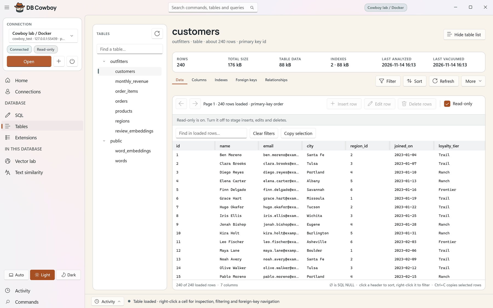
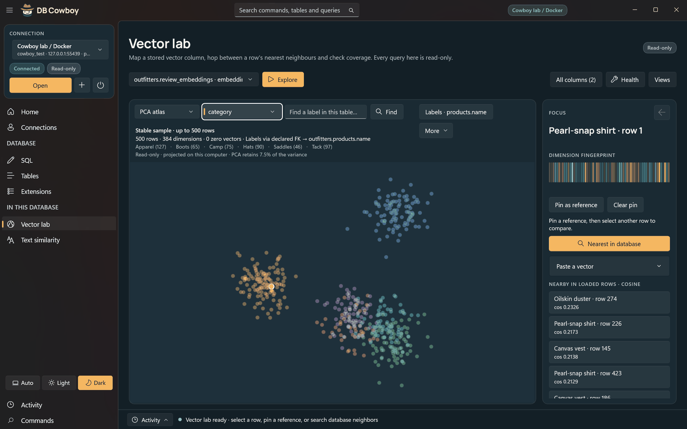

<div align="center">


# DB Cowboy

**Your data. Your frontier.** A native Windows workspace for PostgreSQL: SQL, tables, extensions and pgvector exploration.

[Website](https://dbcowboy.site) · [Download](https://github.com/afj176/db-cowboy/releases/latest) · [Installer (x64)](https://github.com/afj176/db-cowboy/releases/latest/download/DbCowboy-Setup-x64.exe) · [Portable ZIP (x64)](https://github.com/afj176/db-cowboy/releases/latest/download/DbCowboy-win-x64.zip)

</div>

<picture>
  <source media="(prefers-color-scheme: dark)" srcset="docs/images/home-dark.png">
  <source media="(prefers-color-scheme: light)" srcset="docs/images/home-light.png">
  
</picture>

## What it does

- **SQL that keeps up with you.** Tabbed queries saved per connection, completion from the connected schema, formatting, EXPLAIN plans, snippets and history. Turn any result into a bar, line, area, scatter, donut or big-number chart and export it as PNG or SVG.
- **Tables you can trust.** Browse rows, columns, indexes with usage counts, foreign keys and a relationship diagram. Inserts, edits and deletes are staged locally and applied in one transaction only after *Review & apply*.
- **Read-only by default.** New connections start read-only; with it off, each run still asks before executing. Production connections can be marked so they stand out.
- **Extensions, explained.** See what the server offers and what is installed, then install, update or remove with the exact statement shown first. Installed extensions with a dedicated view (Query stats for pg_stat_statements, Text similarity for pg_trgm, PostGIS, pg_cron and more) add their own page.
- **Vector lab for pgvector.** Map stored `vector` and `halfvec` columns as a neighbour constellation, PCA atlas or similarity matrix, find the exact nearest rows, and check coverage and index recall. It explores embeddings you already have; it does not create them.
- **Native and local.** A WinUI 3 app with Mica, light and dark themes, and a command search in the title bar (Ctrl+K).

## Screenshots

| SQL with a chart | Tables |
| --- | --- |
|  |  |
| **Vector lab** | **Home, light theme** |
|  |  |

## Install

Download from the [latest release](https://github.com/afj176/db-cowboy/releases/latest):

| | File | Notes |
| --- | --- | --- |
| Installer | `DbCowboy-Setup-x64.exe` (~81 MB) | Per-user install, no administrator rights; adds a Start menu entry and an uninstaller. Requires Windows 11. |
| Portable | `DbCowboy-win-x64.zip` (~95 MB) | Extract the whole folder anywhere and run `DbCowboy.exe`; keep the files next to it. |

SHA-256 checksum files are attached to each release. The builds are not code-signed, so Windows SmartScreen may warn on first run: choose **More info → Run anyway**.

**Requirements:** Windows 11, or Windows 10 version 2004 (build 19041) or later with the portable ZIP; x64. The .NET and Windows App SDK runtimes are included. You need a PostgreSQL server to connect to: local, in Docker or remote.

**Where settings live:** `%LOCALAPPDATA%\DbCowboy` holds `connections.json`, `workspace.json` and `history.json`. Set the `DBCOWBOY_DATA_HOME` environment variable to use another folder. For a self-contained portable copy, create an empty `portable.flag` file next to `DbCowboy.exe`; settings then go to a `data` folder beside it. Saved passwords are protected with Windows data protection for your account, or kept for the app session only.

## Build from source

Prerequisites: Windows 10 2004+ or Windows 11, and the [.NET 10 SDK](https://dotnet.microsoft.com/download). The Windows App SDK and Windows SDK build tools come from NuGet. [Inno Setup 6](https://jrsoftware.org/isinfo.php) is needed only to build the installer.

```powershell
# Debug build
dotnet build src/DbCowboy/DbCowboy.csproj -c Debug -p:Platform=x64

# Release payload and portable zip in artifacts\DbCowboy-<version>-win-x64
.\scripts\Publish.ps1 -Version 0.43.1

# ...plus the installer
.\scripts\Publish.ps1 -Version 0.43.1 -Installer -InnoCompiler "C:\Program Files (x86)\Inno Setup 6\ISCC.exe"
```

`Publish.ps1` refuses to overwrite an existing release folder, so pass a version that has not been published yet. It also checks that no profile data ends up in the payload.

To try the app against a disposable database, start a pgvector container, then run the app with `--integration-ui`; it connects a read-only profile to `127.0.0.1:55439 / cowboy_test`. Set `DBCOWBOY_DATA_HOME` first to keep the run out of your real profile.

```powershell
docker run -d --name cowboy-test -p 127.0.0.1:55439:5432 -e POSTGRES_HOST_AUTH_METHOD=trust -e POSTGRES_DB=cowboy_test pgvector/pgvector:pg17
```

### Checks

```powershell
dotnet run --project tests/DbCowboy.ChartChecks   # chart model and rendering; no database needed
dotnet run --project tests/DbCowboy.Checks        # data layer; needs the container above (PostgreSQL 17 or 18)
.\tests\ReleasePayloadChecks.ps1                  # release payload guard; no database needed
```

`DbCowboy.VectorChecks` and `DbCowboy.ConnectionChecks` are read-only checks against a vector dataset. They need `DBCOWBOY_CHECK_CONNECTION` set to a local database (for example `Host=127.0.0.1;Port=55439;Database=cowboy_vectors;Username=postgres;SSL Mode=Disable`); `tests/DbCowboy.VectorChecks/fixture.sql` builds a suitable dataset in an empty pgvector database.

More on the source layout and the release steps: [docs/README.md](docs/README.md).

## Privacy

Everything stays on your computer. DB Cowboy talks only to the PostgreSQL servers you connect to; it has no telemetry, accounts or update checks. The only other network use is when you click an extension's *Documentation* link, which opens in your browser.

## License

[MIT](LICENSE). Third-party components are listed in [THIRD-PARTY-NOTICES.md](THIRD-PARTY-NOTICES.md). The Manrope font is under the SIL Open Font License 1.1.
