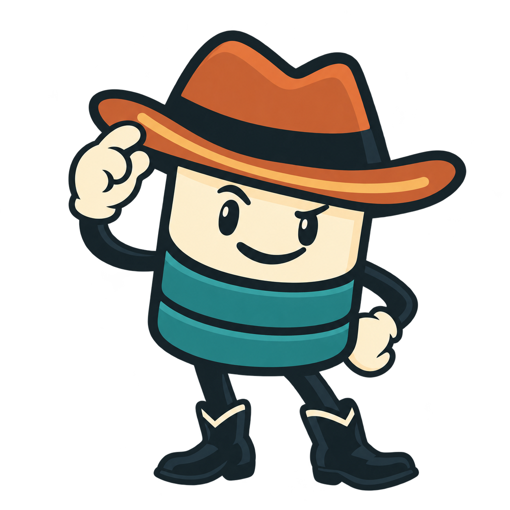
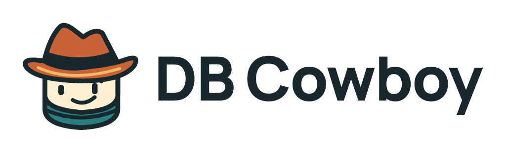
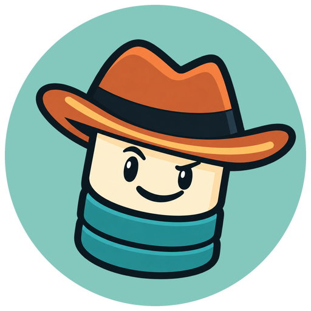
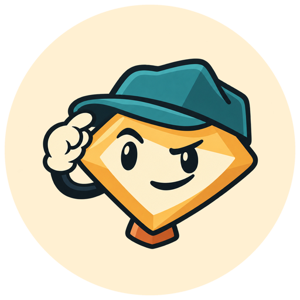
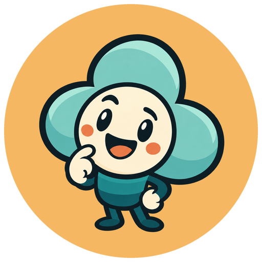

# DB Cowboy brand guide

DB Cowboy is a native Windows workspace for PostgreSQL: SQL tabs, table editing, extensions and a lab for pgvector embeddings. It is a serious everyday tool, and the identity lets it be a little mischievous as well. The cowboy is the database itself, a cylinder in a swept copper hat, and the tagline says who is in charge: **Your data. Your frontier.**

<picture>
  <source media="(prefers-color-scheme: dark)" srcset="logo-kit/png/brand-reversed-1024w.png">
  
</picture>

## The mascot

**Rowdy** is a living database. His cream face sits on two petrol-teal data tiers, under a wide copper hat with an amber band. One raised brow and a crooked smile do the talking. He is confident, a bit cheeky and always on your side.

Two smaller characters keep him company. **Dash** is an index: an amber diamond in a teal cap, sharp and wry. **Dot** is an embedding: a round face among three mint lobes, curious and cheerful.

  

Where Rowdy appears in the app:

- **Home.** The full-body Rowdy tips his hat beside the tagline. There is a light and a dark drawing, and he steps aside when the window gets narrow.
- **Empty states.** A reaction sits above a short title and one next step. "Got you" invites a start ("Your first connection starts here"), "Wait, what?" marks an empty list or a search with no match, and "I'm done" appears when something could not be read. A fourth reaction, "That's good", ships with the app and has no page yet.
- **Connections.** Each saved connection can wear Rowdy, Dash or Dot, or stay plain. The character shows at 32 px in the sidebar, without the round backdrop.
- **Title bar, taskbar and installer.** Rowdy's head is the icon everywhere.

Please don't:

- Put Rowdy on the working surfaces. The SQL editor, result grids and table editor stay plain.
- Use him to soften an error or a destructive action. The message says what happened; Rowdy only sets the mood.
- Use the full-body drawing as a small icon. Below about 64 px use the symbol, which is drawn for that size.
- Crop away his hat, face or boots, or recolour him.

## Logo

| File (in `logo-kit/svg`, PNG copies in `logo-kit/png`) | Use it for |
| --- | --- |
| `brand-primary-outlined` | The default: Rowdy's head and the wordmark side by side, on light backgrounds. |
| `brand-reversed` | The same lockup with a cream wordmark, for dark backgrounds. |
| `brand-secondary-outlined` | The stacked version, for square or narrow spaces. |
| `brand-symbol` | Rowdy's head alone: app icons, avatars, favicons. |
| `brand-mono` | One-colour printing. The head becomes a plain hat-and-cylinder shape. |
| `brand-wordmark-outlined` | The lettering alone, when Rowdy is already nearby. |

- **Minimum size.** In marketing and print, keep the horizontal logo at least 180 px wide and the symbol at least 24 px. The app's 48 px title bar uses a compact 146 × 32 px lockup, which is fine there because the window frames it. The 16 px icon is a simplified hat and cylinder, without the face.
- **Clear space.** Leave a margin as tall as the lowercase "o" of the wordmark on every side.
- **Do** use the SVG wherever you can, the PNG where you cannot, and the reversed logo on dark backgrounds.
- **Don't** stretch, rotate or recolour the logo, add shadows or outlines, or set the name in a font yourself. The wordmark is drawn artwork (Manrope at weight 800, converted to outlines).

`logo-kit/preview/logo-usage.png` shows the four main versions on one sheet.

## Colour

The palette is warm paper and ink, with Rowdy's copper for action and his teal for good news. `tokens.json` and `tokens.css` hold the same values for code.

**Light theme**

| Swatch | Hex | Used for |
| --- | --- | --- |
| Paper | `#F8F4EC` | Page background |
| White | `#FFFFFF` | Cards and panels; text on copper buttons |
| Ink | `#19272E` | Text, the wordmark and Rowdy's outlines |
| Muted | `#58656A` | Secondary text and captions |
| Action | `#A64F22` | The accent: links, selected items, check boxes, progress, the default button in dialogs |
| Saddle | `#B55D32` | Primary buttons on pages, with a white label |
| Copper | `#C76335` | Rowdy's hat and decoration. Not for text |
| Cream | `#FFF0D2` | Rowdy's face and the reversed wordmark |
| Amber | `#F5B761` | The hat band and the glow behind the Home banner |
| Teal | `#287F80` | Rowdy's data tiers; "connected" and other good-news pills; the focus ring on the website |
| Danger | `#B43D3C` | Warnings and errors, such as the Production pill |
| Line | `#7B8A90` | Hairline borders, at 24% opacity |

**Dark theme**

| Swatch | Hex | Used for |
| --- | --- | --- |
| Slate | `#131F26` | Page background |
| Raised | `#1A2A33` | Cards and panels |
| Night | `#101B21` | Text on amber buttons; the background of the social graphics |
| Paper | `#F8F4EC` | Text |
| Silver | `#B3C3CB` | Secondary text; hairline borders at 16% opacity |
| Amber | `#F5B761` | The accent and primary buttons, with Night text |
| Mint | `#84C8BD` | Good-news pills |
| Coral | `#F08C87` | Warnings and errors |

Contrast, measured with the WCAG formula: Ink on Paper is 14.0:1, Muted on Paper 5.5:1, Action on Paper 5.1:1, white on Action 5.6:1 and white on Saddle 4.6:1. In dark, Paper on Slate is 15.3:1, Silver on Slate 9.3:1 and Night on Amber 9.9:1. Copper (3.6:1) and Teal (4.3:1) fall short of 4.5:1 on Paper, so keep them to shapes, pills and large type. When Windows high contrast is on, the app drops the brand colours and uses the system ones.

## Typography

- **Manrope** (SIL Open Font License 1.1) for the wordmark, page titles, dialog titles and big numbers. Headings are bold; the wordmark is weight 800. The font file and its licence are in `logo-kit/fonts`.
- **Segoe UI Variable**, the Windows system font, for controls and body text. It is part of Windows and is not shipped with the app.
- **Cascadia Mono**, falling back to Consolas, for SQL.

## Voice

Direct and capable, with a little swagger kept for the welcome moments. Controls say exactly what they do.

| Write | Rather than |
| --- | --- |
| "Run statement", "Review & apply", "Find a table" | "Giddy up!", "Wrangle it" |
| "Your first connection starts here" | "No connections found." |
| "Ready when you are" | "No results to display." |
| "No connection matches. Try part of a name, host, database or username." | "Whoa there, partner! Nothing in these parts." |
| "This saved password could not be decrypted. Enter it again for this Windows account." | "Oops! Something went wrong." |
| "New connections start read-only. Turn it off and each run still asks first." | "Enterprise-grade safety built in." |

The cowboy lives in the drawing and the tagline, not in the buttons. Errors are plain and say what to do next. Destructive actions are never a joke.

## Files in this folder

| Path | What it holds |
| --- | --- |
| `tokens.json`, `tokens.css` | The palette, light and dark theme colours and fonts, for code |
| `logo-kit/svg`, `logo-kit/png` | The logo versions listed above (PNG at 512 to 4096 px wide; the symbol from 64 to 2048 px) |
| `logo-kit/favicon` | Favicons, touch icons and a web manifest |
| `logo-kit/preview` | The logo usage sheet |
| `logo-kit/fonts` | Manrope and its licence |
| `icons` | The Windows icon (`windows.ico`), its PNG sizes from 16 to 1024 px and a maskable web icon |
| `avatars` | Rowdy, Dash and Dot on round backdrops, 512 px |
| `graphics` | Rowdy's full-body drawing for light and dark backgrounds, the profile picture, a 1500 × 500 header, and 1200 × 630 and 1080 × 1080 share images |

The app keeps its own copies of the art it shows, including the reactions, in [`src/DbCowboy/Assets`](../src/DbCowboy/Assets). The website is in [`site`](../site).

## Licence

Everything in this repository, code and artwork alike, is under the [MIT licence](../LICENSE). Manrope is under the [SIL Open Font License 1.1](logo-kit/fonts/LICENSE-Manrope.txt).
